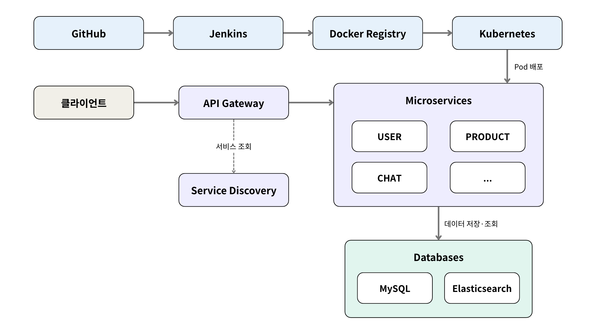

# Momnect

육아용품 중고거래 서비스. 자녀 연령에 맞는 상품을 추천하고, 지역·연령·상품 상태 조건으로 중고 육아용품을 검색·거래할 수 있는 웹 서비스입니다.

<br>

## 1. 프로젝트 개요

| 항목 | 내용 |
|---|---|
| 서비스 | 육아용품 중고거래 플랫폼 (Momnect) |
| 개발 기간 | 2025.07 – 2025.09 (2개월) |
| 팀 구성 | 5명(각 도메인별로 프론트엔드와 백엔드를 함께 담당)|
| 저장소 구성 | `backend/` (Spring Boot 마이크로서비스 9개), `frontend/` (Next.js) |

**기획 의도**

- 육아용품은 사용 기간이 짧아 중고 수요가 크지만, 일반 중고거래 플랫폼에서는 자녀 연령 기준으로 상품을 찾기 어렵습니다.
- 회원이 등록한 자녀의 생년월일을 기준으로 추천 연령대 상품을 노출하고, 추천 연령·거래 지역·상품 상태 조건으로 검색할 수 있게 구성했습니다.

**아키텍처 선택 배경**

모놀리식 구조에서는 일부 기능 수정에도 전체를 다시 배포해야 하고, 특정 도메인만 확장하기 어려우며, 한 모듈의 장애가 서비스 전체로 이어집니다(SPOF). 이를 해소하기 위해 도메인 단위로 서비스를 분리한 MSA 구조를 채택했습니다.

<br>

## 2. 담당 역할 및 핵심 구현 (My Role & Key Contributions)

**담당 범위:** MSA·백엔드 CI/CD 구축 전담, product(상품/검색), file(이미지 관리) 도메인 API 및 UI 개발

### 2-1. MSA 구성 — 서비스·DB 분리, API Gateway 단일 진입점, REST 기반 서비스 간 통신

- **도메인 단위 서비스 분리**
  `user` / `product` / `chat` / `websocket` / `post` / `review` / `file` 서비스를 독립된 Spring Boot 애플리케이션(개별 Gradle 프로젝트)으로 분리했습니다. 서비스마다 자체 엔티티·리포지토리를 갖고, 다른 도메인 데이터는 API 호출로만 조회합니다.
- **서비스 디스커버리** — `discovery-service`
  Spring Cloud Netflix Eureka Server(`:8761`). 각 서비스는 기동 시 Eureka에 자신의 주소를 등록하고, Gateway와 Feign 클라이언트는 고정 IP·포트 대신 서비스 이름으로 대상을 찾습니다. 서비스 포트는 `server.port: 0`(빈 포트 자동 할당)으로 두고 인스턴스 ID에 랜덤 값을 붙여, 같은 서비스를 여러 개 띄워도 포트 충돌 없이 각각 등록되도록 했습니다.
- **API Gateway** — `gateway-service`
  Spring Cloud Gateway(`:8000`)를 외부 요청의 단일 진입점으로 구성했습니다.
  - `/api/v1/{service}/**` 경로를 `lb://{SERVICE}`로 라우팅하고 `RewritePath`로 prefix 제거 (`lb://`: Eureka에 등록된 해당 서비스 인스턴스 중 하나를 Spring Cloud LoadBalancer가 골라 요청을 전달)
  - 전역 `JwtAuthenticationFilter`에서 JWT를 검증한 뒤 `X-User-Id`, `X-User-Role` 헤더로 사용자 정보를 하위 서비스에 전달 → 토큰을 발급하는 `user-service`를 제외한 도메인 서비스는 JWT를 다시 검증하지 않고 헤더 기반 인증 필터(`HeaderAuthenticationFilter`)만 사용
  - CORS 정책 일원화, 서비스별 Swagger 문서(`/v3/api-docs`)를 Gateway에서 통합 조회
- **서비스 간 통신**
  Spring Cloud OpenFeign으로 REST 호출을 구성했습니다. 예) `product-service` → `user-service`(자녀 정보), `review-service`(리뷰 수), `file-service`(이미지 URL)
- **DB 분리**
  회원·상품·게시글·리뷰·채팅·파일 서비스는 각각 독립된 MySQL DB를 사용합니다(`spring.datasource.url`을 서비스별 환경변수 `DB_URL`로 주입). 서비스 간 조인 없이 필요한 데이터는 API로 조회합니다. 이 밖에 채팅 메시지는 MongoDB, 실시간 상태(안 읽은 메시지 수 등)는 Redis, 상품 검색은 Elasticsearch를 사용합니다.

### 2-2. 백엔드 CI/CD 파이프라인 구축 및 자동 배포

[`backend/Jenkinsfile`](backend/Jenkinsfile) · [`backend/_k8s/`](backend/_k8s) · 서비스별 `Dockerfile`

```
GitHub push → Jenkins(githubPush 트리거) → 변경된 서비스 감지 → 해당 서비스만 Docker 이미지 빌드 → Docker Hub push → Kubernetes rollout restart
```

- **이미지 빌드**: 서비스마다 멀티 스테이지 Dockerfile 작성 (`gradle:8.7.0-jdk17`에서 빌드 → `eclipse-temurin:17-jre` 런타임 이미지에 jar만 복사)
- **Jenkins 파이프라인**: GitHub push 이벤트로 트리거되어 kubeconfig 자격증명으로 대상 Deployment를 `rollout restart`하여 롤링 방식으로 재배포
- **변경 서비스만 선택 배포**: 마지막으로 성공한 빌드의 커밋과 현재 커밋을 `git diff --name-only`로 비교해, 파일이 바뀐 서비스 폴더만 빌드·배포. 실패한 빌드의 변경분은 다음 성공 빌드 때 함께 반영되고, 이전 성공 커밋이 없으면(첫 빌드) 전체 배포. 필요 시 `DEPLOY_ALL` 파라미터로 전체 재배포
- **Kubernetes 배포**: `momnect` 네임스페이스에 서비스별 Deployment 구성, `imagePullPolicy: Always`로 재시작 시 최신 이미지 반영. 외부 진입점인 `gateway-service`(NodePort `30080`)와 `discovery-service`만 Service로 노출
- **설정 외부화**: DB 접속 정보, JWT 시크릿, Eureka 주소(`DEFAULT_ZONE`), Elasticsearch·FTP 주소 등은 `application.yml`에서 `${ENV}` 형태로 참조하고 Kubernetes Secret(`app-secret`)으로 주입

### 2-3. 파일 도메인 API 개발 (`file-service`)

상품·프로필 이미지를 관리하는 서비스입니다. 다른 서비스는 이미지 파일 대신 이미지 ID만 저장하고, 필요할 때 `file-service`에서 경로를 조회합니다.

- `POST /files`: 다중 이미지 업로드. Apache Commons Net `FTPClient`로 외부 파일 서버에 업로드하고(저장 파일명은 새로 생성), 원본 파일명·저장 경로·크기·확장자 메타데이터를 MySQL에 저장한 뒤 이미지 ID 목록 반환
- `GET /files?ids=1,2,3`: 이미지 ID 목록으로 메타데이터 일괄 조회 — `product-service`·`user-service`가 OpenFeign으로 호출해 이미지 URL을 구성
- `GET /files/server-url`: 파일 서버 기본 URL 조회
- `GET /files/path`, `DELETE /files/path`: 파일 서버 디렉토리의 이미지 목록 조회 및 일괄 삭제(관리용)

### 2-4. 상품/검색 도메인 API 및 UI 개발 (`product-service`, `frontend/src/app/product`, `main`)

- **Elasticsearch 상품 검색** (`elasticsearch-java` 8.15 클라이언트)
  - 상품 등록 시 MySQL 저장과 함께 `products` 인덱스에 `ProductDocument`를 색인 (해시태그, 거래지역 ID, 대표 이미지 경로 등 검색·목록 표시에 필요한 필드를 비정규화)
  - `POST /products/search`: `BoolQuery`로 키워드(상품명·본문·해시태그 `match`)와 카테고리, 가격 범위, 추천 연령, 거래 지역, 상품 상태, 판매완료 제외 필터를 조합하고 최신순/가격순 정렬 및 페이징 처리
  - `GET /products/similar`: 키워드 기반 유사 상품 조회(판매완료·삭제 상품 제외, 최대 30건)
- **홈 상품 섹션** (`GET /products/sections`)
  인기·신규·추천 Top 30. 추천은 `user-service`에서 자녀 생년월일을 조회해 연령 구간(0–6개월 ~ 4–6세 등)으로 변환한 뒤 해당 연령 상품을 조회하고, 외부 호출 실패 시 인기 상품으로 폴백합니다.
- **상품·거래 API**
  상품 등록/상세(판매자 정보, 판매자의 다른 상품 포함), 찜 등록·취소·목록, 거래 상태 변경 및 판매 완료 처리, 내 구매/판매 내역, 거래 현황 요약, 카테고리 트리, 행정구역(거래 지역) 조회
- **프론트엔드 UI**
  메인 상품 섹션, 상품 검색(필터·정렬), 상품 상세, 상품 등록/수정, 거래 지역 검색 컴포넌트, 찜 목록 사이드바 구현 및 API 연동

### 결과

- 서비스별로 독립 개발·배포·확장이 가능한 구조
- 특정 도메인 장애가 다른 서비스로 확산되는 범위 최소화 (예: 추천 섹션은 `user-service` 호출 실패 시 인기 상품으로 대체)

**핵심 기술 스택:** Java 17, Spring Boot 3.4, Spring Cloud, MySQL 8, Elasticsearch 8.15, React

<br>

## 3. 시스템 아키텍처



**요청 흐름**

1. 클라이언트 요청은 모두 Gateway(`/api/v1/{service}/**`)로 들어옵니다.
2. Gateway가 JWT를 검증하고 `X-User-Id`, `X-User-Role` 헤더를 추가한 뒤, Eureka에서 조회한 인스턴스로 로드밸런싱(`lb://`)합니다.
3. 각 서비스는 헤더 기반으로 인증 정보를 처리하고(`user-service`는 JWT 직접 검증), 다른 도메인 데이터가 필요하면 OpenFeign으로 해당 서비스를 호출합니다.

**서비스 구성**

| 서비스 | 역할 | 저장소 / 외부 연동 |
|---|---|---|
| `gateway-service` | 단일 진입점, 라우팅, JWT 검증, CORS, Swagger 통합 | — |
| `discovery-service` | Eureka 서비스 레지스트리 | — |
| `user-service` | 회원가입/로그인(JWT), 회원 정보, 자녀 정보 | MySQL |
| `product-service` | 상품, 검색, 찜, 거래, 카테고리, 지역 | MySQL, Elasticsearch |
| `chat-service` | 채팅방, 메시지 조회, 안 읽은 메시지 수 | MongoDB, Redis, MySQL |
| `websocket-service` | STOMP 메시지 송수신, 읽음 처리 | Redis |
| `post-service` | 커뮤니티 게시글, 댓글, 좋아요 | MySQL |
| `review-service` | 거래 리뷰, 리뷰 AI 요약 | MySQL, OpenAI API |
| `file-service` | 이미지 업로드 및 URL 조회 | MySQL, FTP 파일 서버 |

**CI/CD 흐름**

```
[Backend]   GitHub push → Jenkins → 변경 서비스 감지 → Docker build → Docker Hub → Kubernetes rollout restart
[Frontend]  push(main) → GitHub Actions → Docker build → Amazon ECR → AWS Elastic Beanstalk
```

<br>

## 4. 기술 스택

### Backend

| 구분 | 기술 |
|---|---|
| Language | Java 17 |
| Framework | Spring Boot 3.4.8, Spring Security, Spring Data JPA |
| MSA | Spring Cloud 2024.0.2 — Gateway, Netflix Eureka, OpenFeign |
| 인증 | JWT (jjwt 0.12.6) |
| 검색 | Elasticsearch Java Client 8.15.0 |
| 실시간 통신 | Spring WebSocket (STOMP) |
| API 문서 | springdoc-openapi (Swagger UI) |
| 기타 | ModelMapper, Apache Commons Net(FTP), Apache POI(행정구역 데이터 적재), Jsoup |

### Frontend

| 구분 | 기술 |
|---|---|
| Framework | Next.js 15.4.5 (App Router), React 19.1.0 |
| 상태 관리 | Zustand |
| HTTP | Axios |
| 실시간 통신 | @stomp/stompjs, sockjs-client |
| UI | Tailwind CSS 4, Radix UI, lucide-react |
| 에디터 | CKEditor 5, Toast UI Editor |
| 기타 | react-daum-postcode |

### Infra & DB

| 구분 | 기술 |
|---|---|
| RDB | MySQL 8|
| 검색 엔진 | Elasticsearch 8.15 |
| NoSQL / Cache | MongoDB, Redis |
| AI | OpenAI API (리뷰 요약) |
| CI/CD | Jenkins (Backend), GitHub Actions (Frontend) |
| 배포 | Docker, Docker Hub, Kubernetes (Backend) / Amazon ECR, AWS Elastic Beanstalk (Frontend) |

<br>

## 5. 주요 기능

| 도메인 | 기능 |
|---|---|
| 회원 | 회원가입, 로그인/로그아웃, 토큰 재발급, 계정 찾기·비밀번호 재설정, 프로필 수정, 회원 탈퇴 |
| 자녀·지역 | 자녀 정보 등록/수정/삭제, 거래 지역 설정 |
| 상품 | 상품 등록, 상세 조회, 찜, 홈 섹션(인기·신규·자녀 연령 기반 추천), 유사 상품 |
| 검색 | 키워드 검색 + 카테고리·가격·추천 연령·거래 지역·상품 상태 필터, 정렬 |
| 거래 | 거래 상태 변경, 판매 완료 처리, 구매/판매 내역, 거래 현황 요약 |
| 채팅 | 1:1 실시간 채팅(STOMP), 안 읽은 메시지 수, 읽음 처리 |
| 리뷰 | 거래 리뷰 작성·조회, 긍정/부정 리뷰 AI 요약 |
| 커뮤니티 | 게시글 작성(에디터, 이미지 업로드), 댓글, 좋아요 |

API 명세는 Gateway의 통합 Swagger UI에서 서비스별로 확인할 수 있습니다.

<br>

## 6. 프로젝트 구조

```
momnect/
├── backend/
│   ├── gateway-service/       # Spring Cloud Gateway, JWT 필터 (각 서비스 폴더에 Dockerfile 포함)
│   ├── discovery-service/     # Eureka Server
│   ├── user-service/          # 회원, 인증, 자녀
│   ├── product-service/       # 상품, 검색(Elasticsearch), 찜, 거래, 카테고리, 지역
│   ├── chat-service/          # 채팅방, 메시지 (MongoDB, Redis)
│   ├── websocket-service/     # STOMP 메시지 브로커
│   ├── post-service/          # 커뮤니티
│   ├── review-service/        # 리뷰, AI 요약
│   ├── file-service/          # 이미지 업로드 (FTP)
│   ├── open-ai-service/       # OpenAI 공용 호출 컴포넌트
│   ├── _k8s/                  # 서비스별 Kubernetes Deployment / Service
│   ├── Jenkinsfile            # 백엔드 CI/CD 파이프라인
│   └── README.md
│
└── frontend/
    ├── .github/workflows/     # GitHub Actions 배포 파이프라인
    ├── Dockerfile             # 멀티 스테이지 빌드 (standalone)
    ├── Dockerrun.aws.json     # Elastic Beanstalk 배포 정의
    └── src/
        ├── app/
        │   ├── (user)/        # 로그인, 회원가입, 마이페이지, 자녀·지역 관리 등
        │   ├── main/          # 메인 (상품 섹션)
        │   ├── product/       # 상품 상세 / 등록·수정 / 검색
        │   ├── chat/          # 채팅
        │   ├── review/        # 리뷰
        │   └── post/          # 커뮤니티
        ├── components/        # 공통 컴포넌트, UI 컴포넌트
        ├── lib/               # API 클라이언트(axios), WebSocket 매니저
        ├── store/             # Zustand 스토어
        └── enums/             # 상품 상태, 거래 상태, 연령대, 정렬 옵션
```

각 서비스 내부는 `command/{controller, service, repository, entity, dto, client}` 구조를 따릅니다.

**관련 문서**

- 백엔드 상세: [`backend/README.md`](backend/README.md)
- 프론트엔드 상세: [`frontend/README.md`](frontend/README.md)
- OpenAI 공용 컴포넌트: [`backend/open-ai-service/.../README_OpenAiCommonService.md`](backend/open-ai-service/src/main/java/com/momnect/openaiservice/common/README_OpenAiCommonService.md)
