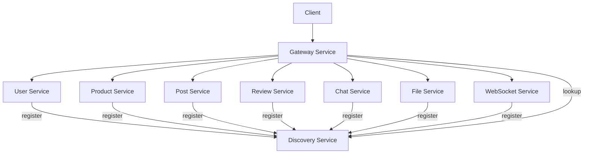

# Momnect Backend

Momnect(육아용품 중고거래 서비스)의 백엔드입니다. Spring Boot + Spring Cloud 기반으로 도메인별 서비스를 분리했고, Jenkins와 Kubernetes로 배포합니다.

전체 프로젝트 소개와 아키텍처는 [루트 README](../README.md)를 참고하세요.

## 기술 스택

| 구분 | 기술 |
|---|---|
| Language / Build | Java 17, Gradle (서비스별 독립 프로젝트) |
| Framework | Spring Boot 3.4.8, Spring Security, Spring Data JPA |
| MSA | Spring Cloud 2024.0.2 — Gateway, Netflix Eureka, OpenFeign, LoadBalancer |
| 인증 | JWT (jjwt 0.12.6), BCrypt |
| DB / 검색 | MySQL 8, MongoDB, Redis, Elasticsearch (Java Client 8.15.0) |
| 실시간 통신 | Spring WebSocket, STOMP (SockJS fallback) |
| 파일 | FTP 파일 서버 (Apache Commons Net) |
| AI | OpenAI API (리뷰 요약) |
| API 문서 | springdoc-openapi (Swagger UI, Gateway에서 통합 조회) |
| CI/CD · 배포 | Jenkins, Docker, Docker Hub, Kubernetes |

> `file-service`는 Spring Boot 3.5.5 / Spring Cloud 2025.0.0, `websocket-service`는 Spring Boot 3.2.0 / Spring Cloud 2023.0.0을 사용합니다.

## 서비스 구성

| 서비스 | 포트 | 역할 | 저장소 / 외부 연동 |
|---|---|---|---|
| `discovery-service` | 8761 | Eureka 서비스 레지스트리 | — |
| `gateway-service` | 8000 | 단일 진입점, 라우팅(`lb://`), JWT 검증, CORS, Swagger 통합 | — |
| `user-service` | 0\* | 회원가입/로그인, 회원 정보, 자녀 정보 | MySQL |
| `product-service` | 0\* | 상품, 검색, 찜, 거래, 카테고리, 지역 | MySQL, Elasticsearch |
| `post-service` | 0\* | 커뮤니티 게시글, 댓글, 좋아요 | MySQL, FTP 파일 서버 |
| `review-service` | 0\* | 거래 리뷰, 평점, 리뷰 AI 요약 | MySQL, OpenAI API |
| `chat-service` | 0\* | 채팅방, 메시지 조회, 안 읽은 메시지 수 | MySQL, MongoDB, Redis |
| `websocket-service` | 0\* | STOMP 메시지 송수신, 읽음 처리 | Redis |
| `file-service` | 0\* | 이미지 업로드 및 메타데이터 조회 | MySQL, FTP 파일 서버 |

\* 포트 0: 기동 시 빈 포트를 자동 할당받아 Eureka에 등록합니다. Gateway와 Feign은 포트가 아닌 서비스 이름으로 호출합니다.

MySQL을 사용하는 서비스는 서비스마다 독립된 DB를 사용합니다. 다른 도메인 데이터는 DB 조인이 아니라 OpenFeign API 호출로 조회합니다.

### 요청 흐름



1. 모든 요청은 Gateway의 `/api/v1/{service}/**`로 들어옵니다. (`/auth/signup`, `/auth/login`, `/users/check`는 인증 없이 통과)
2. Gateway가 JWT를 검증하고 `X-User-Id`, `X-User-Role` 헤더를 붙여 Eureka에서 찾은 인스턴스로 전달합니다.
3. 도메인 서비스는 `HeaderAuthenticationFilter`로 헤더의 사용자 정보를 인증 객체로 변환합니다. 토큰을 발급하는 `user-service`는 자체 `JwtAuthenticationFilter`로 JWT를 직접 검증합니다.

## 프로젝트 구조

```
backend/
├── discovery-service/      # Eureka Server
├── gateway-service/        # filter/ (JwtAuthenticationFilter), jwt/
├── user-service/           # command/, config/, jwt/, security/, ...
├── product-service/        # command/, config/, security/, ...
├── post-service/
├── review-service/
├── chat-service/
├── websocket-service/      # command/, config/, service/
├── file-service/           # command/, config/, security/, util/
├── open-ai-service/        # OpenAI 공용 호출 컴포넌트 (소스만 포함, 독립 실행 서비스 아님)
├── _k8s/                   # 서비스별 Kubernetes Deployment / Service
└── Jenkinsfile             # CI/CD 파이프라인
```

각 서비스 폴더에는 `build.gradle`과 `Dockerfile`이 있으며, 도메인 서비스 내부는 다음 구조를 따릅니다.

```
com/momnect/{service}/
├── command/
│   ├── controller/
│   ├── service/
│   ├── repository/
│   ├── entity/
│   ├── dto/
│   └── client/             # OpenFeign 클라이언트
├── config/                 # Security, Swagger, Feign 설정
├── security/               # 인증 필터, 인증/인가 예외 핸들러
├── exception/              # GlobalExceptionHandler
└── common/                 # ApiResponse
```

## 배포

### CI/CD (Jenkins)

[`Jenkinsfile`](Jenkinsfile)

```
GitHub push → Jenkins(githubPush 트리거) → 변경된 서비스 감지 → 해당 서비스만 Docker 이미지 빌드 → Docker Hub push → Kubernetes rollout restart
```

- **변경 감지**: 마지막 성공 빌드 커밋(`GIT_PREVIOUS_SUCCESSFUL_COMMIT`)과 현재 커밋을 `git diff --name-only`로 비교해 `{service}/` 하위 파일이 바뀐 서비스만 배포 대상으로 선정
  - 변경된 서비스가 없으면 빌드·배포 단계 생략 (예: `_k8s/`, `README.md`만 수정한 경우)
  - 첫 빌드 등 비교할 이전 성공 커밋이 없으면 전체 서비스 배포
  - Jenkins에서 `DEPLOY_ALL` 파라미터를 체크하고 실행하면 전체 서비스 재배포
- 배포 대상 서비스마다 멀티 스테이지 `Dockerfile`로 이미지 빌드 (`gradle:8.7.0-jdk17` → `eclipse-temurin:17-jre`)
- Docker Hub(`junga970/{service}:latest`)에 push
- kubeconfig 자격증명으로 `momnect` 네임스페이스의 대상 Deployment만 `rollout restart`
- `_k8s/` 매니페스트 변경은 파이프라인이 적용하지 않으므로 `kubectl apply`로 직접 반영
- 트리거 대상 브랜치는 Jenkins job 설정에서 지정합니다.

### Kubernetes

[`_k8s/`](_k8s)

- 서비스별 Deployment (`imagePullPolicy: Always`로 재시작 시 최신 이미지 반영)
- 외부 노출: `gateway-service` NodePort `30080`, `discovery-service` NodePort `30061`
- 설정값은 `application.yml`에서 `${ENV}`로 참조하고, Secret `app-secret`을 `envFrom`으로 주입
- MySQL을 사용하는 서비스는 Secret의 서비스 전용 키(`USER_DB_URL`, `PRODUCT_DB_URL`, `POST_DB_URL`, `REVIEW_DB_URL`, `CHAT_DB_URL`, `FILE_DB_URL`)를 `DB_URL`로 주입받아 각자의 DB에 연결

```bash
kubectl create namespace momnect
kubectl create secret generic app-secret --from-env-file=.env -n momnect
kubectl apply -f _k8s/ -n momnect
kubectl get pods -n momnect
```

## 관련 문서

- [OpenAI 공용 컴포넌트 사용법](open-ai-service/src/main/java/com/momnect/openaiservice/common/README_OpenAiCommonService.md)
- [프론트엔드 README](../frontend/README.md)
